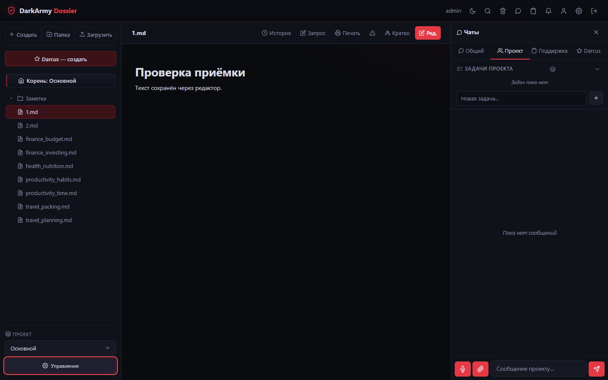
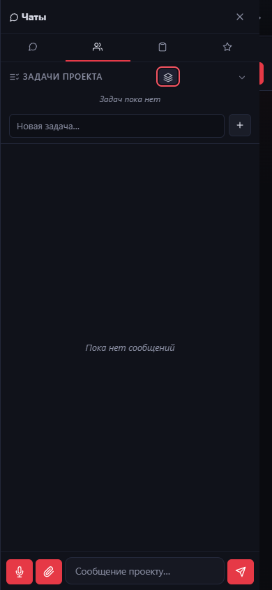
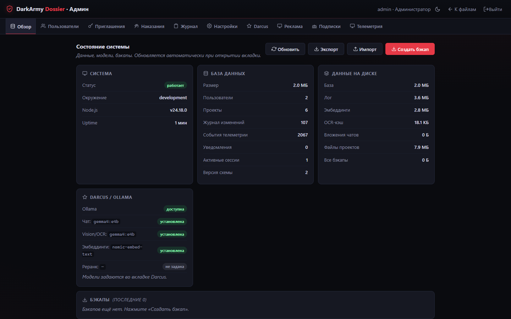

<div align="center">


# DarkArmy Dossier

**Self-hosted рабочее пространство с ИИ: проекты, файлы, совместное редактирование и Darcus.**

[](LICENSE)
[](package.json)
[](test)
[](public/manifest.webmanifest)
[](https://github.com/EvGeNkA-PLUSsss/darkarmy-dossier/issues/new?template=hosted-access.yml)
[](documenti/README.md)

[Сайт проекта](https://evgenka-plussss.github.io/darkarmy-dossier/) ·
[Документация](documenti/README.md) ·
[APK / EXE](release/README.md) ·
[Для ИИ-агентов](AGENTS.md)

</div>

---

## Два способа начать

| | **Готовая версия (Hosted Pro)** | **Свой сервер (Self-hosted)** |
|---|---|---|
| Что это | Мы развернули Dossier — заходите и работайте | Полный код на вашем Ubuntu/Windows |
| Подписка | Платная, выдаётся администратором | Не нужна |
| Лимит файла | **500 МБ** | настраивается |
| Данные | на нашем сервере (можно перенести) | только у вас |
| HTTPS/PWA | из коробки | nginx/Caddy + Let's Encrypt |

**Hosted:** https://147-45-78-20.sslip.io:8443/ · [Запросить доступ](https://github.com/EvGeNkA-PLUSsss/darkarmy-dossier/issues/new?template=hosted-access.yml)

**Self-hosted:**
```bash
git clone https://github.com/EvGeNkA-PLUSsss/darkarmy-dossier.git
cd darkarmy-dossier
sudo DOMAIN=dossier.example.com bash deploy/install-ubuntu.sh
sudo certbot --nginx -d dossier.example.com
```

---

## Возможности

| | |
|---|---|
| **Проекты и роли** | создатель / редактор / участник, приглашения, баны/мьюты, журнал с откатом |
| **Файлы** | дерево, загрузка до 500 МБ по подписке, корзина 14 дней, история версий, PDF/DOCX/XLSX, share-ссылки |
| **Редактор** | Markdown + превью, черновики, автосохранение, общий доступ |
| **Совместная работа** | SSE-синхронизация правок, несколько устройств одного аккаунта, канбан-задачи |
| **Darcus AI** | Ollama, RAG по проектам и встроенным инструкциям, OCR/vision, TTS/STT, ACTION-действия |
| **Офлайн-режим** | скачивание проектов/файлов, просмотр без интернета, редактирование отключено |
| **Уведомления** | центр событий, тикеты, запросы, @упоминания |
| **Админка** | пользователи, инвайты, наказания, журнал, телеметрия, реклама, подписки, баги, голос |
| **Приложения** | PWA, Android APK, Windows EXE, Electron-обёртка |
| **Приватность** | SQLite на диске, без облаков и внешних API по умолчанию |

### Darcus умеет

- отвечать по файлам проекта через RAG;
- распознавать текст на скриншотах и делать полное описание;
- создавать документы (`generate_doc`) и небольшие файлы (`create`), редактировать/удалять/перемещать;
- открывать файлы (`open`), создавать задачи (`task`), запускать поиск (`search`);
- отвечать голосом (Silero) и принимать речь (faster-whisper);
- знать интерфейс и правила приложения из `ai-knowledge/`.

---

## Скриншоты

<p align="center">
  
</p>
<p align="center">
  
  
</p>

---

## Стек

- **Backend:** Node.js 20+, Express 5, `node:sqlite` (SQLite, WAL), SSE
- **Frontend:** vanilla JS SPA без сборки, Markdown, PWA/service worker
- **AI:** Ollama (`gemma4:e4b`, `qwen2.5vl:3b`, `nomic-embed-text`), локальный Silero TTS, faster-whisper
- **Файлы:** обычная ФС (`PROJECTS_ROOT`), SQLite (`data/dossier.db`)
- **Деплой:** systemd + nginx/Caddy, Let's Encrypt, бэкапы

---

## Быстрый старт (Windows)

```powershell
npm install
copy .env.example .env
# заполните SESSION_SECRET, PROJECTS_ROOT
npm start
# http://127.0.0.1:7561
```

Требования: Node.js 20+, для Darcus — Ollama, для голоса — Python 3.10 + Silero/whisper.

---

## Приложения

| Платформа | Как получить |
|---|---|
| Windows | `release/DarkArmyDossier.exe` или PWA |
| Android | `release/DarkArmyDossier.apk` или PWA |
| iOS | Safari → «На экран Домой» |
| Любая | открыть по HTTPS и установить PWA |

В APK/EXE при первом запуске вводится адрес сервера (`ip:port` или домен).

---

## Документация

- [Полная документация](documenti/README.md) — 16 файлов, ~36 000 слов
- [Архитектура](documenti/01-architecture.md) · [API](documenti/04-api.md) · [БД](documenti/05-data-model.md)
- [Darcus AI](documenti/06-ai-darcus.md) · [Совместная работа](documenti/07-collaboration.md)
- [Ubuntu-деплой](documenti/10-deployment-ubuntu.md) · [Бесплатный домен](deploy/free-domain.md)
- [PWA/APK/EXE](documenti/09-desktop-mobile-pwa.md) · [FAQ](documenti/14-faq.md)
- [Для ИИ-агентов](AGENTS.md)

---

## Безопасность

- не коммитьте `.env`, `data/`, `backups/`, сертификаты и ключи;
- в production обязательны `SESSION_SECRET`, `NODE_ENV=production`, HTTPS и `TRUST_PROXY=1`;
- не выставляйте порт 7561 напрямую в интернет — только через nginx/Caddy;
- см. [SECURITY.md](SECURITY.md) и [08-security.md](documenti/08-security.md).

## Лицензия

[AGPL-3.0-only](LICENSE). Используйте, форкайте, разворачивайте; изменения в сетевом сервисе должны быть открыты.
