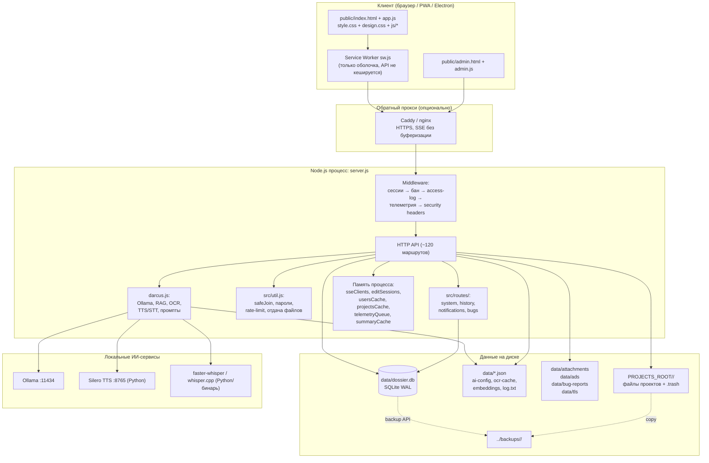
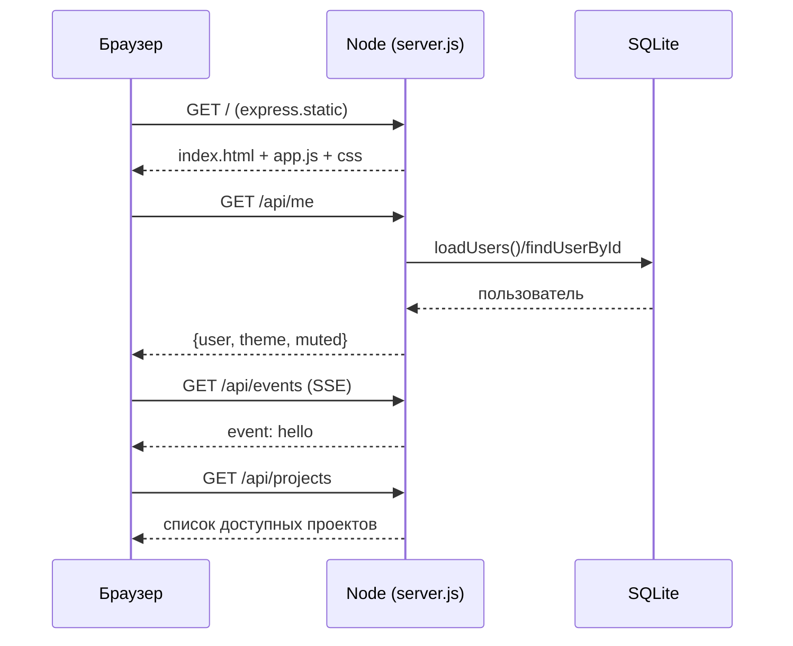
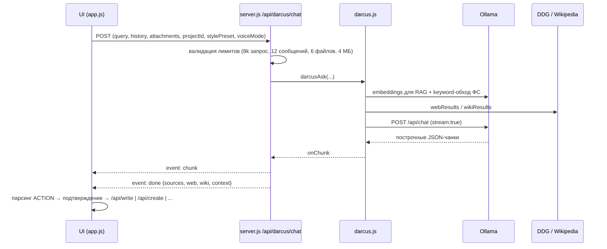

# 01. Архитектура

## Содержание

1. [Общая картина](#общая-картина)
2. [Компоненты системы](#компоненты-системы)
3. [Карта модулей](#карта-модулей)
4. [Потоки данных](#потоки-данных)
5. [Стек и почему именно он](#стек-и-почему-именно-он)
6. [Слои и границы ответственности](#слои-и-границы-ответственности)
7. [Модель реального времени (SSE)](#модель-реального-времени-sse)
8. [Состояние в памяти и его последствия](#состояние-в-памяти-и-его-последствия)
9. [Отказоустойчивость и деградация](#отказоустойчивость-и-деградация)
10. [Ограничения архитектуры](#ограничения-архитектуры)
11. [См. также](#см-также)

---

## Общая картина

DarkArmy Dossier — **монолитное Node.js-приложение** с SPA-фронтендом без сборки,
SQLite-хранилищем метаданных и файловым хранилищем пользовательских документов.
ИИ вынесен в отдельный процесс (Ollama), голос — в отдельные Python-процессы.



---

## Компоненты системы

| Компонент | Файл(ы) | Ответственность | Зависимости |
|---|---|---|---|
| HTTP-сервер и API | `server.js` (≈4 100 строк) | все маршруты, middleware, бизнес-логика, статика, SSE, запуск HTTP/HTTPS | express, express-session, multer, bcryptjs |
| Конфигурация | `config.js` | чтение env, валидация `TRUST_PROXY`, значения по умолчанию, лимиты | — |
| Хранилище метаданных | `src/storage.js` | SQLite-схема, миграции JSON→SQLite, CRUD пользователей/проектов/журнала/телеметрии/сессий/уведомлений/документов, экспорт-импорт | `node:sqlite` |
| Утилиты | `src/util.js` | `safeJoin`, имена файлов, валидация паролей, rate-limit, отдача файлов по allow-list, размеры каталогов, список бэкапов, редакция URL | — |
| Роутеры | `src/routes/system.js`, `history.js`, `notifications.js`, `bugs.js` | админ-дашборд/бэкап/телеметрия, история версий, уведомления, баг-репорты | express, storage, util |
| ИИ | `darcus.js` (≈1 475 строк) | клиент Ollama, RAG (keyword + embeddings + rerank), web/wiki, OCR/vision, промпты, TTS-прокси, STT, суммаризация | Ollama, `extract-text.js`, Python-скрипты |
| Извлечение текста | `extract-text.js` | единая точка извлечения текста из md/txt/docx/xlsx/pdf/pptx | mammoth, xlsx, pdf-parse, officeparser |
| Логирование | `logger.js` | pino при наличии, иначе JSON-fallback; access-log с ротацией 10 МБ × 5 файлов | pino (опционально) |
| Бэкап | `scripts/backup.js` | консистентная копия SQLite через backup API + data + projects, ротация | `node:sqlite` `backup` |
| TTS-сервер | `scripts/silero_tts_server.py` | HTTP `POST /tts`, `GET /health`, Silero v5.6 RU | torch, numpy |
| STT-скрипт | `scripts/faster_whisper_stt.py` | распознавание webm в JSON, hotwords + автоисправления | faster-whisper |
| SPA | `public/index.html`, `public/app.js` | весь пользовательский интерфейс, SSE-клиент, редакторы, чаты, Darcus | vendor-библиотеки |
| Админка | `public/admin.html`, `public/admin.js` | 12 вкладок администрирования | app.js-хелперы частично дублируются |
| Модули фронта | `public/js/search.js`, `history.js`, `notifications.js`, `ui-dialog.js`, `modal-a11y.js`, `login.js`, `register.js` | поиск, история, уведомления, диалоги, доступность модалок, вход/регистрация | глобальные функции `app.js` |
| PWA | `public/manifest.webmanifest`, `public/sw.js`, `public/icons/*` | установка, офлайн-оболочка | HTTPS |
| Desktop | `desktop/electron/*`, `desktop/open-windows-app.cmd` | окно Electron и `--app`-окно Edge/Chrome | electron, electron-builder |
| Тесты | `test/*.test.js` | unit, storage, darcus, ui, API-матрица | `node:test` |

---

## Карта модулей

```
DarkArmyDossier/
├── server.js              Express-приложение: 120+ маршрутов, middleware, SSE, старт
├── config.js              единая точка конфигурации (env → объект cfg)
├── darcus.js              ИИ: Ollama, RAG, OCR, промпты, TTS/STT
├── logger.js              логи (pino/fallback) + access-log
├── extract-text.js        извлечение текста из офисных форматов
├── src/
│   ├── storage.js         SQLite-слой (схема, миграции, документы, сессии, уведомления)
│   ├── util.js            безопасные пути, пароли, rate-limit, отдача файлов
│   └── routes/
│       ├── system.js      /api/admin/*, /api/telemetry*
│       ├── history.js     /api/files/:projectId/history*
│       ├── notifications.js /api/notifications*
│       └── bugs.js        /api/bugs*
├── public/                SPA без сборки
│   ├── index.html         разметка, модалки, иконки (SVG-спрайт)
│   ├── app.js             логика интерфейса (~5 300 строк)
│   ├── admin.html/js      админ-панель
│   ├── style.css          исторические стили
│   ├── design.css         дизайн-токены и компоненты
│   ├── js/                search, history, notifications, ui-dialog, modal-a11y, login, register
│   ├── vendor/            marked, DOMPurify, mammoth, xlsx (локально, без CDN)
│   ├── manifest.webmanifest, sw.js, icons/
├── scripts/               backup.js, silero_tts_server.py, faster_whisper_stt.py
├── deploy/                Caddyfile, nginx.conf, systemd unit, PM2, Windows-задачи, гайд
├── desktop/               Electron-обёртка и .cmd для окна Edge/Chrome
├── data/                  SQLite + JSON-кэши + вложения + логи + TLS (не в git)
└── test/                  node:test: unit, storage, darcus, ui, api
```

---

## Потоки данных

### 1. Запрос страницы



### 2. Открытие и сохранение файла

1. `GET /api/tree?projectId=…` → `projectGuard('read')` → обход ФС `buildTree` (скрывает `.`-элементы).
2. `GET /raw`/`GET /files/:projectId/<path>` → `safeJoin` → `realpath` → проверка префикса →
   `sendProjectFile` (allow-list MIME).
3. Правка: `POST /api/edit/join` (создаёт серверную сессию с baseline), `POST /api/edit/change`
   (обновляет `content`, планирует запись через 500 мс, рассылает `edit-change` участникам),
   `POST /api/edit/save` (немедленная запись + запись в журнал + `edit-saved`),
   `POST /api/edit/leave` (снимает `clientId`; если участников не осталось — flush актуального
   контента и удаление сессии).
4. После сохранения вызывается `refreshEmbedIndex` (фоновая переиндексация чанков).

### 3. Загрузка файла

```
POST /api/upload (multipart, поле file, поле dir, поле projectId)
  ├─ rate-limit 30/мин
  ├─ ранняя проверка Content-Length против лимита из настроек (413 до записи на диск)
  ├─ multer пишет в data/tmp (жёсткий лимит 2 ГБ)
  ├─ projectGuard('edit') по телу запроса
  ├─ cleanupRejectedUpload: при статусе ≥400 временный файл удаляется
  ├─ декодирование имени (latin1→utf8), safeFileName, авто-суффикс « (1)» при коллизии
  ├─ fs.rename в PROJECTS_ROOT
  ├─ logChange('upload')
  ├─ queueImageAnalysis (OCR в фоне, если autoOnUpload)
  └─ refreshEmbedIndex (эмбеддинги в фоне)
```

### 4. Запрос к Darcus



### 5. Событие в реальном времени

```
Действие пользователя → серверное изменение → sseBroadcast / sseSendTo
  → text/event-stream «event: <name>\ndata: <json>\n\n»
  → EventSource на клиенте → точечное обновление UI (без полной перерисовки)
```

---

## Стек и почему именно он

| Решение | Альтернативы | Почему так в этом проекте |
|---|---|---|
| **Express 5** | Fastify, Koa, NestJS | нужен был простой маршрутизатор без сборки и декораторов; Express 5 даёт `{*filePath}`-роуты для путей с кириллицей и вложенными папками |
| **SPA без сборки** (`public/app.js`) | React/Vue + Vite | ноль шага сборки и зависимостей фронта, запуск «из коробки» на Windows; библиотеки вендорены локально для CSP `script-src 'self'` |
| **SQLite (`node:sqlite`)** | PostgreSQL, MongoDB, JSON-файлы | встроен в Node 22+/24 (`DatabaseSync`), не требует отдельного сервера, транзакции и WAL; миграция с JSON сделана автоматической |
| **JSON-документы в SQLite** | отдельные таблицы под каждый тип | быстрый путь для редко меняющихся сущностей (настройки, тикеты, реклама); цена — отсутствие типизации и индексов внутри JSON |
| **SSE** | WebSocket, polling | односторонний канал достаточен (уведомления, чаты, правки); SSE проходит через nginx/Caddy и не требует `ws`-зависимости |
| **Ollama** | OpenAI API, llama.cpp напрямую | локальный запуск моделей без ключей и облака; HTTP API прост и переносим |
| **Silero TTS** | ElevenLabs, браузерный синтез | качественный русский голос локально, без интернета; браузерный синтез остаётся fallback |
| **faster-whisper** | whisper.cpp, Web Speech | точнее на русском и работает по HTTP на телефоне (запись через `<input capture>`) |
| **Electron** | Tauri, PWA | обёртка открывает уже существующий сервер, не требует переписывать UI; Tauri не рассматривался |
| **bcryptjs** | argon2 | чистый JS, без нативной сборки — предсказуемая установка на Windows |
| **node:test** | Jest, Vitest | встроен в Node, ноль зависимостей, достаточен для unit + API-матрицы |

---

## Слои и границы ответственности

```
┌──────────────────────────────────────────────────────────────┐
│ Presentation: public/*.html, app.js, admin.js, design.css    │
│  - не знает о SQLite; общается только через fetch к /api     │
├──────────────────────────────────────────────────────────────┤
│ HTTP/API: server.js, src/routes/*                            │
│  - middleware, валидация входа, права, коды ответов          │
│  - оркестрация: storage + fs + darcus                        │
├──────────────────────────────────────────────────────────────┤
│ Domain helpers: src/util.js, extract-text.js, darcus.js      │
│  - безопасные пути, пароли, лимиты, извлечение текста, ИИ    │
├──────────────────────────────────────────────────────────────┤
│ Persistence: src/storage.js + fs                             │
│  - SQLite-транзакции, JSON-документы, файлы проектов         │
└──────────────────────────────────────────────────────────────┘
```

Правила, которые соблюдаются в коде:

- **Пути пользователя никогда не склеиваются через `path.join` напрямую** — только `safeJoin`
  (нормализация `\` → `/`, запрет NUL, проверка префикса после `path.resolve`).
- **Отдача файлов** — только через `sendProjectFile` с allow-list: изображения/PDF инлайн,
  HTML/JS/SVGZ/XML/неизвестные — `text/plain` или `attachment`, SVG — с закрытым CSP.
- **Права** — `requireAuth` / `requireRole` / `requireSelfAdmin` / `projectGuard(level)`.
- **Журнал** — `logChange` с редакцией секретных файлов (`SENSITIVE_FILE_RE`) и обрезкой
  содержимого до 32 КБ.
- **Ошибки наружу** — общий error handler: для `/api/*` JSON, иначе текст; 413 и 400
  маппятся в человекочитаемые сообщения.

---

## Модель реального времени (SSE)

| Параметр | Значение |
|---|---|
| Endpoint | `GET /api/events` (requireAuth) |
| Формат | `text/event-stream`, `retry: 3000`, heartbeat-комментарий `: ping` каждые 25 с |
| Клиентов на пользователя | не более 5 (`maxSsePerUser`), старые вытесняются |
| Хранение | `Map<username, Set<Response>>` в памяти процесса |
| События | `hello`, `banned`, `chat`, `chat-delete`, `chat-project`, `chat-project-delete`, `project-task`, `edit-change`, `edit-users`, `edit-saved`, `notification`, `request`, `report`, `ticket-new`, `ticket-message`, `ticket-status`, `project-update` |
| Доставка | `sseSendTo(users, event, data)` — адресно; `sseBroadcast` — всем; `sseBroadcastExcept` — всем, кроме списка |
| Обрыв | `req.on('close')` → `sseRemove` → снятие `clientId` из сессий редактирования, flush при отсутствии участников |
| Переподключение | `EventSource` сам; `onerror` в `app.js` пересоздаёт поток через 5 с, если соединение закрыто |

Подробности по событиям совместного редактирования — [07-collaboration.md](07-collaboration.md),
полный справочник событий — [04-api.md](04-api.md#sse-get-apievents).

---

## Состояние в памяти и его последствия

| Структура | Что хранит | Теряется при рестарте | Влияние |
|---|---|---|---|
| `usersCache`, `projectsCache` | массивы пользователей/проектов | нет (восстанавливается из SQLite) | инвалидация при `saveUsers`/`saveProjects` |
| `sseClients` | активные SSE-потоки | да | клиенты переподключаются автоматически |
| `editSessions` | baseline + content + участники | да, но при закрытии последнего участника контент уже записан на диск | потеря несохранённого текста при падении процесса |
| `telemetryQueue` | батчи событий (flush 2 с) | частично | при graceful shutdown очередь сбрасывается |
| `summaryCache` | результаты суммаризации по SHA-1 (24 ч) | да | повторная генерация |
| `visionCapsCache` | поддержка vision у модели | да | один лишний `/api/show` |
| `sileroProc` | PID запущенного Silero | да | автозапуск при следующем старте |

Важно: **все решения о правах** опираются на `loadUsers()`/`loadProjects()`, то есть на SQLite,
а не на кэш сессии. Роль и бан перечитываются на каждом запросе (middleware `req.user`),
поэтому смена роли применяется без перелогина.

---

## Отказоустойчивость и деградация

| Отказ | Поведение |
|---|---|
| Ollama недоступна | `/api/darcus/*` возвращают ошибку; поиск деградирует до keyword (semantic возвращает `[]`); остальной функционал работает |
| embedding-модель не задана/недоступна | `indexFile`/`semanticSearch` возвращают пусто, гибридный поиск остаётся keyword-only |
| vision-модель не vision | OCR/анализ возвращают `error`, результат не кэшируется |
| Silero не запущен | `/api/darcus/tts` → 500; клиент, если `voiceCaps.tts === false`, озвучивает браузером |
| faster-whisper не установлен | `/api/darcus/transcribe` → 500; клиент использует Web Speech API или системный диктофон |
| Обрыв соединения с Ollama | один повтор через 800 мс при `ECONNRESET`/`EPIPE`/таймауте |
| Клиент закрыл вкладку во время стрима | сервер уничтожает запрос к Ollama (слушается `res.on('close')`) |
| Повреждён JSON-кэш (ocr/embeddings) | чтение возвращает пустую структуру, файл перезапишется |
| `uncaughtException` | лог + `flushTelemetry` + `process.exit(1)` (перезапуск systemd/PM2/Планировщиком) |
| SIGTERM/SIGINT | graceful shutdown: закрытие HTTP (до 8 с), flush телеметрии, `storage.close()` |

---

## Ограничения архитектуры

1. **Монолит `server.js`** (~4 100 строк, 120+ маршрутов) — любая правка требует держать
   в голове весь файл; часть логики уже вынесена в `src/routes`, но не вся.
2. **Нет слоя валидации запросов** (схем/валидаторов) — проверки размазаны по обработчикам.
3. **JSON-документы без схемы**: структура `settings`, `tickets`, `ads` и т.п. поддерживается
   кодом, а не БД; миграции для них не автоматические.
4. **`app.js` — монолит** (~5 300 строк, 190+ функций); часть модулей уже вынесена в `public/js`.
5. **Один процесс**: SSE и сессии редактирования не расшарены между инстансами, SQLite-файл
   один — горизонтальное масштабирование невозможно без переезда на Redis/Postgres.
6. **Синхронный обход ФС** в поиске/RAG и синхронная запись файлов — при больших проектах
   запросы блокируют event loop.
7. **Нет очереди задач**: OCR и индексация запускаются «в фоне» через `setImmediate`/IIFE
   и при рестарте теряются.
8. **Один HTTPS-порт** с тем же приложением; отдельного TLS-терминатора внутри нет
   (продакшен предполагает reverse proxy).

---

## См. также

- [README.md](README.md) — обзор и быстрый старт.
- [02-installation.md](02-installation.md) — установка и `.env`.
- [04-api.md](04-api.md) — маршруты и SSE-события.
- [05-data-model.md](05-data-model.md) — схема SQLite и файлы.
- [06-ai-darcus.md](06-ai-darcus.md) — как устроен ИИ-слой.
- [07-collaboration.md](07-collaboration.md) — SSE-редактирование.
- [08-security.md](08-security.md) — границы доверия и защита.
- [10-deployment-ubuntu.md](10-deployment-ubuntu.md) — развёртывание.
- [12-development.md](12-development.md) — как менять код.
