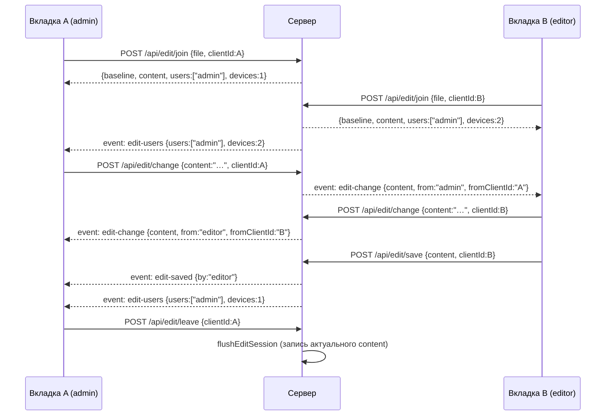

# 07. Совместное редактирование

## Содержание

1. [Что это и чего это не делает](#что-это-и-чего-это-не-делает)
2. [Два редактора](#два-редактора)
3. [Как это работает на сервере](#как-это-работает-на-сервере)
4. [clientId: вкладки и устройства](#clientid-вкладки-и-устройства)
5. [Последовательность открытия и правки](#последовательность-открытия-и-правки)
6. [SSE-события](#sse-события)
7. [Права и роли](#права-и-роли)
8. [Ограничения и известные проблемы](#ограничения-и-известные-проблемы)
9. [Диагностика](#диагностика)
10. [См. также](#см-также)

---

## Что это и чего это не делает

Совместное редактирование в DarkArmy Dossier — это **синхронизация содержимого файла
между открытыми редакторами** одного проекта через SSE.

Реализовано:

- несколько пользователей (и несколько вкладок/устройств одного пользователя) видят
  изменения друг друга в реальном времени;
- индикатор «редактируют: логин1, логин2 (N устройств)»;
- автосохранение на сервере с задержкой 500 мс;
- сохранение набранного текста при закрытии вкладки, обрыве SSE и выходе из редактора;
- черновики в `localStorage` (переживают перезагрузку страницы);
- событие «X зафиксировал изменения» при явном сохранении.

Не реализовано ❌:

- OT/CRDT и автоматическое слияние конфликтов — **last-write-wins**;
- курсоры, выделения и «печатает…» других участников;
- блокировки файла (lock) и очередь правок;
- разрешение конфликта «оба изменили одно и то же» — молча применяется последняя правка;
- история правок внутри сессии (только запись `edit` в журнал при сохранении);
- WebSocket/бинаурый протокол — только SSE.

---

## Два редактора

| Свойство | Inline-редактор | Модальный редактор |
|---|---|---|
| Как открыть | кнопка «Ред.» в filebar | контекстное меню файла → «Редактировать» |
| Где живёт | область просмотра (`#inlineEditor`) | модальное окно (`#editorModal`) |
| Превью | справа, отключается кнопкой «глаз» | справа |
| Кнопки | «Сохранить» + «✕» в filebar | «Сохранить» / «Отмена» |
| Черновик | `da_drafts[projectId::path]`, `da_openEditors` | черновик не сохраняется между перезагрузками |
| Восстановление после reload | да (редактор переоткроется с черновиком) | нет |
| Участие в SSE-сессии | да | да |
| Ограничение | на мобильном превью занимает половину экрана | закрывается по `Esc` как «Отмена» |

Оба используют один и тот же API (`/api/edit/*`) и одну серверную сессию на пару
`projectId + file`, поэтому участники видны друг другу независимо от того, какой
редактор открыт.

---

## Как это работает на сервере

Ключ сессии: `editKey(projectId, file) = projectId + '::' + file`.

В памяти процесса (`editSessions: Map`):

```js
{
  baseline: "<содержимое на момент первого join>",
  content:  "<актуальное содержимое>",
  users:    Map<clientId, {username, joinedAt}>,
  saveTimer: Timeout | null,
  projectId, file
}
```

### `POST /api/edit/join`

1. `requireAuth` + `projectGuard('edit', 'body')`.
2. Проверка, что файл текстовый (`isTextFile`) и существует.
3. Если сессии нет — читается `baseline` (текущее содержимое файла).
4. `users.set(clientId, {username, joinedAt})`.
5. Всем участникам уходит `edit-users` c `users` и `devices`.
6. Ответ: `{baseline, content, users, devices}`.

### `POST /api/edit/change`

1. Проверки прав/типа/размера (до 5 МБ).
2. Сессия должна существовать, иначе `410 session ended`.
3. `s.content = content`, планируется запись на диск через 500 мс (`scheduleSessionSave`).
4. Всем участникам сессии — `edit-change` с `content`, `from` (логин) и `fromClientId`.
5. Ответ `{ok:true}`. Запись в журнал на этом шаге **не** делается.

### `POST /api/edit/save`

1. Отменяет отложенную запись.
2. `before = s.baseline`, `s.content = content`, `s.baseline = content`.
3. Немедленная запись файла.
4. `logChange({action:'edit', before, after})` — с редакцией секретных и обрезкой 32 КБ.
5. `refreshEmbedIndex` — переиндексация в фоне.
6. `clientId` удаляется из сессии (редактор считается закрытым).
7. `edit-users` и `edit-saved` всем оставшимся.
8. Если участников не осталось — сессия удаляется.

### `POST /api/edit/leave`

1. `clientId` удаляется.
2. Если участников нет — `flushEditSession`: записывается **актуальный `content`**,
   а не `baseline` (это исправление критичного бага: раньше закрытие вкладки откатывало
   автосохранённый текст), и в журнал добавляется запись `edit` с `details: autosave on session end`.
3. Иначе — `edit-users` всем оставшимся.

### Обрыв SSE

`GET /api/events` при закрытии соединения вызывает `sseRemove`:

- удаляются все `clientId`, чьи `username` совпадают с пользователем;
- если сессия опустела — flush и удаление;
- иначе — `edit-users`.

То есть обрыв связи не теряет текст: он записывается на диск.

### Запись на диск

`scheduleSessionSave` перезаписывает файл через 500 мс после последней правки.
Дополнительная защита: `flushEditSession` при завершении сессии. Промежуточные версии
на диск не пишутся — журнал фиксирует только `join`-состояние и финальное `save`/`leave`.

---

## clientId: вкладки и устройства

- Генерируется в браузере и хранится в `sessionStorage` под ключом `da_edit_client_id`
  (`getEditClientId()` в `public/app.js`).
- `sessionStorage` уникален для вкладки: **новая вкладка = новый clientId**.
- Дублирование вкладки браузером может скопировать `sessionStorage` — тогда две вкладки
  будут считать себя одним клиентом (редкий случай).
- Если `crypto.randomUUID` недоступен (HTTP в LAN), используется `safeUuid()`
  на `crypto.getRandomValues`/`Math.random`.
- `clientId` обрезается сервером до 80 символов.

Зачем нужен:

1. Различать несколько устройств **одного** аккаунта: событие `edit-change` игнорируется
   только если `fromClientId === мой clientId`; другое устройство того же логина
   изменение применит.
2. Показывать корректное число устройств (`devices`).
3. Корректно снимать участие: `save`/`leave` удаляют именно свой `clientId`, а не все
   записи пользователя.

Если `clientId` не передан, сервер подставляет `username` — тогда все вкладки одного
пользователя неразличимы, а `save` удалит запись по имени пользователя.

---

## Последовательность открытия и правки



Типичные проблемы синхронизации:

| Симптом | Причина |
|---|---|
| Чужой текст не появляется | другой проект (`projectId !== state.projectId`) или файл не открыт в редакторе |
| Свой текст «откатывается» | пришло `edit-change` от другого клиента с более старым содержимым (last-write-wins) |
| Счётчик устройств не тот | продублирована вкладка (общий `sessionStorage`) или клиент не передаёт `clientId` |
| «Редактируют: …» висит после закрытия | не отправлен `leave`, SSE-соединение не закрыто; помогает перезагрузка |
| Сохранение «не проходит» | `410 session ended` — сессия закрыта (все ушли/сервер перезапустился), нужно снова «Ред.» |

---

## SSE-события

Все три события приходят только участникам конкретной сессии (`sseSendTo` по списку
`username`, полученному из `users`).

### `edit-users`

```json
{ "key":"default::docs/a.md", "projectId":"default", "file":"docs/a.md",
  "users":["admin","editor"], "devices":2 }
```

Обновляет индикатор состава. Приходит на `join`, `save`, `leave` и при обрыве SSE.

### `edit-change`

```json
{ "key":"default::docs/a.md", "projectId":"default", "file":"docs/a.md",
  "content":"<полный текст>", "from":"admin", "fromClientId":"<uuid>" }
```

Клиент:

- игнорирует, если проект/файл не открыт;
- игнорирует, если `fromClientId` совпадает с собственным;
- сохраняет позицию курсора (обрезая её по длине нового текста);
- заменяет значение `textarea` и обновляет превью.

⚠️ Передаётся **весь документ** на каждое изменение (без diff), поэтому при больших
файлах и быстрой печати трафик заметный.

### `edit-saved`

```json
{ "key":"default::docs/a.md", "projectId":"default", "file":"docs/a.md", "by":"editor" }
```

Показывает тост «editor зафиксировал изменения».

Формат кадра SSE:

```
event: edit-change
data: {"key":"…","content":"…"}

```

---

## Права и роли

| Действие | member | editor | creator | admin сайта |
|---|---|---|---|---|
| Читать файл | ✓ | ✓ | ✓ | ✓ |
| Открыть редактор (`edit/join`) | — | ✓ | ✓ | ✓ |
| Отправлять правки | — | ✓ | ✓ | ✓ |
| Сохранять | — | ✓ | ✓ | ✓ |
| История/diff | ✓ | ✓ | ✓ | ✓ |
| Откат версии | — | — | — | ✓ |

Проверка прав выполняется на **каждом** запросе `edit/*` через `projectGuard('edit')`,
поэтому смена роли применяется без перезапуска редактора: следующий `change` вернёт
`403 forbidden`.

Дополнительно: SSE-события правок уходят только участникам сессии (а не всем клиентам,
как было в ранней версии), что закрывает утечку текста посторонним.

---

## Ограничения и известные проблемы

1. **Last-write-wins.** Если два человека правят один абзац, победит тот, чьё изменение
   пришло последним. Никаких маркеров конфликта нет.
2. **Полный документ в каждом `edit-change`.** На файле 200 КБ и активной печати
   это десятки килобайт в секунду на каждого участника.
3. **Курсор прыгает.** Позиция восстанавливается приблизительно; при вставке текста
   в начало документа курсор может оказаться не там.
4. **Нет «печатает…»** и подсветки чужого выделения.
5. **Автосохранение раз в 500 мс** — при падении процесса между правкой и flush
   можно потерять до 0,5 с ввода.
6. **Черновики только для inline-редактора**; модальный редактор при перезагрузке
   текст не восстановит.
7. **Переключение проекта с открытым inline-редактором** сохраняет черновик под ключом
   нового проекта (известный баг фронтенда, описан в `docs/ROADMAP.md`); перед сменой
   проекта лучше сохранить и закрыть редактор.
8. **`session ended`** после рестарта сервера: сессии редактирования в памяти, файл
   при этом уже записан благодаря flush/leave, но продолжить правку нужно заново.
9. **Один процесс.** Два инстанса приложения не увидят сессии друг друга.
10. **Нет ограничения на число участников** одной сессии — только на SSE-потоки (5 на
    пользователя).

---

## Диагностика

```bash
# Кто сейчас в сессиях (только в отладочной сборке/через код)
# В рантайме список не экспортируется — смотрите SSE-индикатор в UI.

# Проверить, что SSE вообще работает
curl -N -b cookies.txt http://127.0.0.1:7561/api/events
# ожидаем: retry: 3000, event: hello, затем ": ping" раз в 25 с

# Проверить сессию редактирования вручную
curl -b cookies.txt -H "Content-Type: application/json" \
  -d '{"projectId":"default","file":"docs/a.md","clientId":"test-1"}' \
  http://127.0.0.1:7561/api/edit/join
# {"baseline":"…","content":"…","users":["admin"],"devices":1}
```

Чек-лист при рассинхроне:

1. Одинаковый ли проект открыт в обеих вкладках?
2. Открыт ли файл в редакторе (а не только в просмотре)?
3. Нет ли `403` в сетевой панели (нет права edit)?
4. Не `410` ли приходит на `change` (сессия закрыта — переоткрыть «Ред.»)?
5. Проверьте SSE: в DevTools → Network → `events` должен быть статус `pending`
   и периодические `ping`.
6. Не открыт ли тот же файл в модальном и inline-редакторе одновременно в одной вкладке —
   это допустимо, но правки применяются к тому редактору, который активен
   (`state.editingFile` имеет приоритет при совпадении).

---

## См. также

- [01-architecture.md](01-architecture.md) — место SSE в архитектуре.
- [03-user-guide.md](03-user-guide.md) — как выглядит редактор.
- [04-api.md](04-api.md#совместное-редактирование) — контракты `edit/*`.
- [08-security.md](08-security.md) — права и разграничение доступа.
- [11-troubleshooting.md](11-troubleshooting.md) — SSE/прокси и обрывы.
- [12-development.md](12-development.md) — где менять логику редактора.
